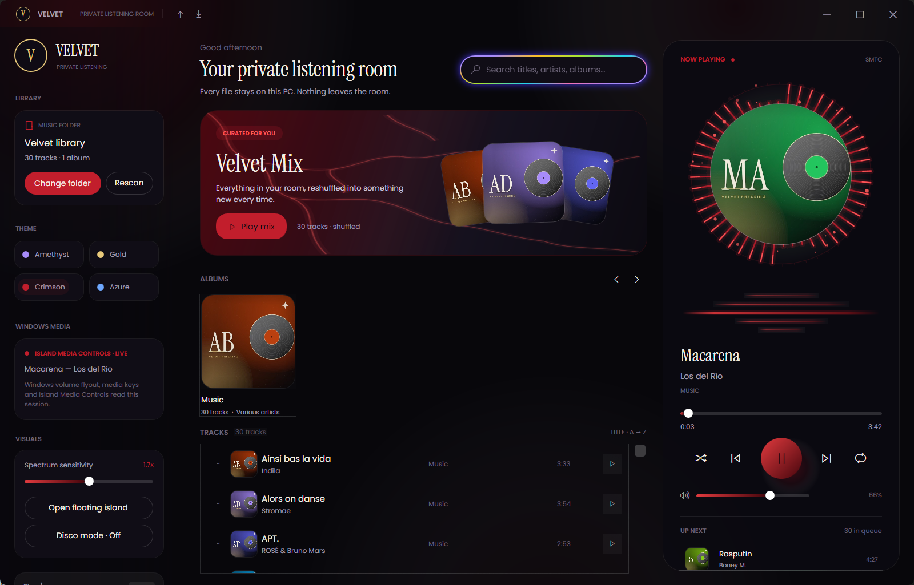
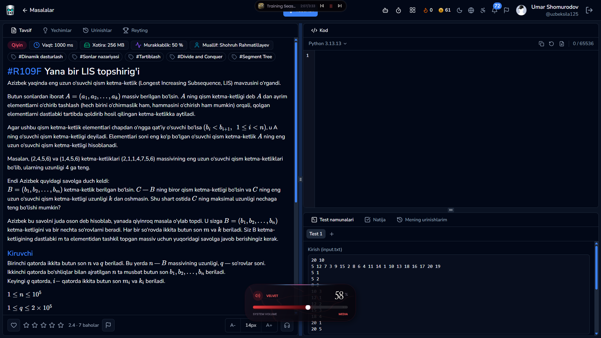
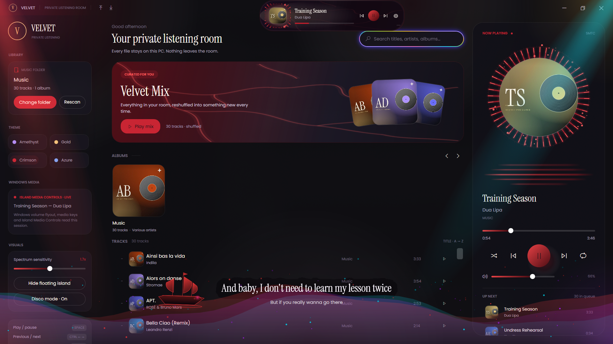
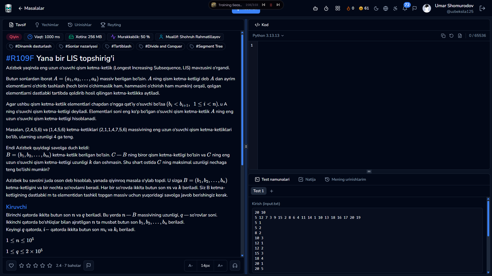

# Velvet

**Your music. Everywhere. No ads. No paywall.**

Velvet is a local music player for Windows and Android, built around the files you already own. It has a floating dynamic island, a real spectrum visualizer, a custom volume controller, and Velvet Cloud — a hosted copy of the shared library that both apps can pull from.

[](LICENSE)




## Download

| Platform | File | Requirements |
| --- | --- | --- |
| Windows 10 2004+ / 11 (x64) | [`Velvet.exe`](Velvet.exe) | None — self-contained, no .NET install |
| Android 8.0+ | [`Velvet-2.0.1.apk`](Velvet-2.0.1.apk) | None |

The Windows build is a single self-contained executable. It carries its own .NET runtime, WPF, and native libraries, so a fresh PC can double-click it and play. There is no separate dependency installer to run.

### Installing on Android

The APK installs on a phone that has never had Velvet before. No old version is required.

1. Download `Velvet-2.0.1.apk` and open it from your notifications or file manager.
2. If Android asks, allow **Install unknown apps** for the browser or file manager you are using. On many phones this is **Settings → Apps → Special app access → Install unknown apps**.
3. If Play Protect shows a warning, tap **More details → Install anyway**. Velvet is signed by the project, not distributed through Play, so Play Protect has no reputation data for it.

## What's new in 2.0.1

- **Clean installs on Android.** The APK is signed with the v1, v2, and v3 schemes, so a phone that has never had Velvet installed can install it directly. OEM installers and Play Protect can still block any side-loaded APK; the steps above cover those prompts.
- **Lyrics are only shown when they are real.** Velvet no longer stretches unsynced text across a track to fake a moving stage. A line appears only when a synced catalogue match clears the title, artist, and duration checks, and `[offset:]` values are honoured. A sidecar is also rejected when its last line falls outside the audio, so a 34-second clip or a shortened edit cannot borrow another cut's timing. The lyric clock now runs on the frame clock and re-anchors only after a real seek or skip, so it does not drift or reset every half second.
- **Artists survive a cloud download on mobile.** The Velvet Cloud manifest now carries each track's ID3 title, artist, and album, and the Android scan uses that catalogue when a downloaded file has weak or missing tags. No more "Unknown artist" for tracks that clearly have an artist. This also unblocks online lyric lookup, because Velvet will not search with an unknown artist.

## What's new in 2.0

- **Fireworks locked to the kick** — bursts are triggered by onsets measured against a slow bass baseline with an adaptive threshold and a tempo-derived gate, so they land on the beat instead of drifting between frames. Each burst throws a trailing shell, a white-hot core, falling embers and a flash, and the whole stage shoves on the hit.
- **Waves that breathe instead of snapping** — the low band now rises with a fast attack and falls with a slow release on both platforms. The liquid follows the music instead of jumping to every sample.
- **No more white ball** — the hard white lamp dot at every beam fixture and the ship light are gone. Beams are read from their soft tinted fixtures only.
- **Lyrics that load, match, and follow a seek** — a track loads its sidecar or cached lyrics instantly, then does one network pass with a hard 8-second budget. Matching is scored by normalised title, artist, and duration on both Windows and Android, so a cover or a same-name track no longer wins. Seeking and skipping re-anchor the lyric clock immediately instead of waiting for the next half-second tick. **Search again** forgets a bad cache entry and retries.
- **Artists on every mobile surface** — the player header, now-playing rows, mini player, and queue all show the artist, with clear fallbacks for untagged files.
- **Velvet channel past 100% again** — the mixer slider maps its whole track to 0–150%, commits the continuous value, and the playback service applies it at startup. Velvet can sit above a game or video again.
- **Disco rebuilt around sound, not shapes** — soft beams enter from real fixtures at the edges, theme-coloured liquid rolls with the low end, and fireworks detonate above the floor. Every run starts with a different palette, burst order and ship path; nothing is precomputed or stored.
- **Instant response** — the extra attack smoothing between the FFT and the stage is gone, so the wave lands with the kick instead of a beat later.
- **Mobile holds 60 FPS** — spectrum updates no longer recompose the player screen. The disco stage, ring and strip animate in the draw phase with pooled particles, cached brushes and solid strokes, and the strip no longer builds forty gradients per frame. Lyrics advance on a frame clock rather than the half-second progress tick.
- **A notification that belongs to the app** — framed, glowing artwork, a ticker with the artist, the queue position in the subtext, and no auto-dismiss while music is playing.
- **Tray media follows the island** — Velvet publishes an explicit AppUserModelID and re-publishes its SMTC status and timeline on every UI tick, including while paused, so tray mods read the same clock as the island. The session is shut down cleanly when Velvet exits.
- **New home** — the project now lives at [`VantaStealth/Velvet-LocalMusicStreamingPlayer`](https://github.com/VantaStealth/Velvet-LocalMusicStreamingPlayer), including Velvet Cloud.

## Velvet Cloud

Velvet Cloud lives on a public GitHub release, outside this repository:

```
https://github.com/VantaStealth/Velvet-LocalMusicStreamingPlayer/releases/download/velvet-cloud/manifest.json
```

- The manifest and all 30 tracks are hardcoded into both apps. There is nothing to configure.
- Each track can publish a `.lrc` next to its audio. Cloud downloads bring the matching lyric sidecar with them.
- On launch, both apps notice which cloud tracks are missing from your selected folder and offer to download them.
- Android can download from Velvet Cloud. There is no upload button on mobile, so the cloud cannot be filled by strangers.
- Desktop can download and publish. Publishing uses your local GitHub credential (Git Credential Manager); `tools/publish-cloud.mjs` is the command-line path used to seed the release.
- A partial download is deleted, not left behind as a broken track.
- **The release must stay public.** Private GitHub release assets require an authenticated request, and the apps download anonymously. Making the release private would break cloud downloads for both apps.

### Backup mirrors

Every track can carry a `mirrors` array in the manifest. Both apps try the primary URL, then each backup in order, and only report failure when every source fails. If the release manifest itself disappears, clients fall back to the committed manifest in the repository and its CDN copy.

Mirrors are configured only in the backend. Neither app shows, names, or links a backup host. To add an S3-compatible store, set `VELVET_MIRRORS` before running the publisher with a JSON array of endpoints:

```json
[
  {
    "endpoint": "https://<account>.r2.cloudflarestorage.com",
    "bucket": "velvet-cloud",
    "region": "auto",
    "accessKey": "...",
    "secretKey": "...",
    "publicUrl": "https://music.example.com"
  }
]
```

The publisher signs and uploads each track with AWS Signature V4, skips files already present with the right size, and writes the public URLs into the manifest. Credentials stay in the environment and are never written to the repository, the manifest, or either app.

**No host can guarantee that copyrighted media will never be removed.** Backups reduce the chance that one takedown breaks every client; they are not immunity. Velvet Cloud contains copyrighted recordings, so keep your own copy of the library. Use backup storage you control and are allowed to use.

### Lyrics

Open **LYRICS** on Android or **Disco mode** on desktop. Velvet resolves lyrics in this order:

1. A `.lrc` file beside the track (`Song.mp3` → `Song.lrc`).
2. The lyric sidecar published with that track in Velvet Cloud.
3. A runtime lookup against a public synced-lyrics catalogue.

Every candidate is scored against the track before it is used: the title and artist are normalised (brackets, `feat.`, remaster/radio edits and punctuation are stripped) and compared, and the duration has to be close. Velvet accepts only a genuinely synced result. A plain-text result is not turned into fabricated timings. A sidecar whose last line lands outside the actual audio (a 34-second clip, a shortened edit, a slowed remix) is rejected as well, so one cut cannot wear another cut's timing. If nothing scores high enough, Velvet says the track has no lyrics instead of showing the wrong ones. A bad cache entry can be discarded with **Search again**.

Timed `[mm:ss.xx]` lines follow playback on a frame clock, honour `[offset:±ms]`, and re-anchor immediately on a seek or skip. Lyrics are cached locally after the first lookup. `tools/fetch-lyrics.mjs` fills in sidecars for a local library and `tools/publish-cloud.mjs` uploads them beside the audio.

## Volume controller, everywhere

**Windows.** While Velvet is running — including from the tray at boot — the volume keys are captured system-wide. Velvet steps the Windows media volume through Core Audio and draws its own compact glass HUD at the bottom of the screen. The stock Windows volume flyout is suppressed. Mute works too.



*Changing volume with the minimal island still on top.*

**Android.** Android hides accessibility access for sideloaded apps until you allow it. Open **Settings → Apps → Velvet**, tap the **three-dot menu**, and choose **Restricted access** (or **Allow restricted settings**). Then return to Velvet, open the **three-dot menu**, and choose **Volume keys takeover**. Enabling the Velvet accessibility service lets volume key presses open the full Velvet volume pill anywhere on the phone: on the lock screen, inside games, or with nothing playing at all. The floating orb panel is near-opaque for readability, and its liquid, bubbles, and level readout ease into every change. Drag anywhere on the rail to pick any level; Velvet keeps the continuous value and commits the closest step the device exposes. Tap **MIX** on the pill for Media, Ring, Alerts, Alarm, Calls, and the Velvet channel, and set an exact percentage for each one. The service only filters volume keys and never reads screen content.

Android exposes one shared media stream to every app, so the mixer controls device streams while the **Velvet channel** slider is separate; it can push Velvet from 0% to **150%** so it sits above a game or video.

## The floating island





*The one-line minimal island stays on top of whatever you are doing. The problem above is a real hard task from RoboContest, not a mock-up.*

- Drag it anywhere; it snaps to the top edge and to the horizontal centre.
- Double-click to switch between the full island and the one-line minimal island.
- The minimal island shows cover, title, time, previous, play/pause, and next.
- Drag its right edge to resize it horizontally.
- While dragging, a glowing blue centre line appears when the minimal island is snapped to the top middle, then disappears when you release.
- Resize, rotate, opacity, and minimal state are remembered between launches.
- It follows the same playback clock as the tray media session, so both read the same time at all times.

## On Android

<table>
  <tr>
    <td align="center"><br><sub>Library</sub></td>
    <td align="center"><br><sub>Spectrum</sub></td>
    <td align="center"><br><sub>Volume mixer</sub></td>
  </tr>
  <tr>
    <td align="center"><br><sub>Volume rail</sub></td>
    <td align="center"><br><sub>Media notification</sub></td>
    <td align="center"><br><sub>Lock screen</sub></td>
  </tr>
</table>

- Media3 playback service with a framed, accent-tinted notification.
- Procedural cover art for tracks without embedded artwork.
- Favourites, sorting, search, albums, and a daily Velvet Mix.
- **DISCO** mode for beat-synced lights, spark bursts, and animated lyrics.
- Per-stream mixer for media, ring, alerts, alarms, and calls, plus the 150% Velvet channel.

## Everything in Velvet

### Library

- Point Velvet at a folder and it indexes MP3, M4A/AAC, FLAC, WAV, OGG, Opus, and WMA files, tags, and embedded artwork.
- Automatic rescan when the folder changes; the Windows app can also rescan on demand.
- Search across title, artist, and album.
- Sort by title, artist, album, or duration.
- Favourites, with a dedicated filter.
- Album view with a full album track list.
- Daily Velvet Mix — a fresh rotation that changes each day.
- Track durations, album names, and clear fallbacks for files with missing tags.
- Drag-and-drop or picker-based folder selection, remembered between launches.
- A scan screen that reports the file being read and overall progress.

### Playback

- Background playback that survives the window closing on Windows and the app leaving the foreground on Android.
- Real media sessions: SMTC and media keys on Windows, Media3 session and lock-screen controls on Android.
- Play/pause, previous, next, seek, shuffle, and queue position.
- Playback continues from the tray on Windows; the tray icon opens the app.
- Velvet registers at boot and stays out of the way — it is not forced open on login.
- Audio focus handling on Android, so Velvet pauses for calls and other players.
- No ads, no tracking, no account.

### Visuals

- 48-band playback analysis drives the desktop lines, the mobile visualizer, the disco stage, and the vein beat response.
- Desktop spectrum visualizer with a smoothed low-end response.
- Desktop disco mode: sourced spotlights and corner washes, a liquid floor, kick-locked fireworks, embers, shockwaves, a passing ship, and an animated lyric stage.
- Mobile disco mode: the same sound-driven stage, plus a spectrum ring and an animated lyric strip, all drawn at 60 FPS.
- Each disco run picks its own palette, burst order, and ship path at runtime.
- Per-track procedural cover art for tracks without embedded artwork, generated deterministically from the track.
- Animated glow sliders, liquid transitions, and framed artwork throughout the apps.

Velvet is polished, clean, and cool without the disco mode. Disco is still included — it is not perfect, but it is here just because.

### Velvet Cloud

- Hosted shared library of 30 tracks, hardcoded into both apps; nothing to configure.
- Missing-track detection with a one-tap download offer on launch.
- Track audio and matching `.lrc` sidecars download together.
- Download progress, cancellation, and automatic cleanup of partial files.
- Backend-only mirror failover, plus manifest fallbacks through the repository and its CDN copy.
- Publishing from desktop through GitHub Credential Manager.

### Volume

- System-wide volume key takeover on Windows with a custom glass HUD.
- Full-screen volume pill on Android through the optional accessibility service.
- Continuous drag anywhere on the rail, not just the device's discrete steps.
- Near-opaque, readable panel with liquid, bubbles, and a live level readout.
- Per-stream mixer for media, ring, alerts, alarm, and calls.
- Separate Velvet channel from 0% to 150%.
- In-app volume HUD when the accessibility service is off.
- The Windows hook is active only while Velvet runs; quitting returns the keys to Windows.

### Desktop shell

- Floating dynamic island with snap-to-top, snap-to-centre, and a blue snap line.
- Full and minimal island layouts, double-click switching, and horizontal resize.
- Remembered island geometry, rotation, opacity, and mode.
- Portable custom window chrome: rounded corners, custom title bar, per-monitor DPI awareness, and work-area clamping.
- Tray-first design with a white tray icon and a clean session shutdown.
- Velvet Cloud download and publish from the app.
- Local settings, library cache, generated covers, and logs in `%LOCALAPPDATA%\Velvet`.

### Android shell

- Jetpack Compose UI with a bottom mini player and a full player screen.
- Onboarding for first-run folder selection.
- Favourites, albums, search, sorting, and the daily mix.
- DISCO mode and LYRICS mode with synced line animation.
- Framed media notification with artwork, artist ticker, queue position, and no auto-dismiss while playing.
- Lock-screen artwork and controls.
- Procedural covers, accent theming, and haptic-feeling transitions.

## First run

1. Start Velvet and choose the folder that holds your music.
2. Velvet scans it and remembers the folder permission.
3. If Velvet Cloud has tracks that folder does not, a banner offers to download them.
4. On Windows, close the window when you are done — playback continues from the tray.

Settings, the library cache, generated covers, and logs live in `%LOCALAPPDATA%\Velvet` on Windows.

## Repository layout

```
app/                        Android app (Kotlin, Jetpack Compose, Media3)
desktop/Velvet.Desktop/     Windows app (C#, WPF, NAudio, TagLibSharp)
docs/                       Desktop screenshots
mobile screenshots/         Android screenshots used above
tools/                      Cloud publishing, lyric fetching, and screenshot helpers
```

Audio files are **not** stored in this repository. They live in the public `velvet-cloud` GitHub release and are downloaded by the apps.

## Build from source

### Windows

Requirements: Windows 10 2004+ or Windows 11, and the [.NET 8 SDK](https://dotnet.microsoft.com/download/dotnet/8.0).

```powershell
dotnet publish desktop/Velvet.Desktop/Velvet.Desktop.csproj -c Release -o publish
```

`publish/Velvet.exe` is a self-contained single-file build. Copy it anywhere and run it.

### Android

Requirements: JDK 17 and the Android SDK.

```powershell
.\gradlew.bat assembleDebug
```

The APK lands in `app/build/outputs/apk/debug/`.

### Publishing to Velvet Cloud

`tools/fetch-lyrics.mjs` fills in `.lrc` sidecars from track tags before publishing. `tools/publish-cloud.mjs` reconciles the `velvet-cloud` release with your local library: it uploads new tracks and their lyrics, replaces changed ones, removes tracks you deleted, rebuilds `manifest.json`, and republishes it. It reads a GitHub token from Git Credential Manager; no token is stored in this repository.

```powershell
node tools/fetch-lyrics.mjs "C:\Users\You\Velvet Cloud"
node tools/publish-cloud.mjs
```

## Notes

- Velvet never modifies your audio files. Cloud downloads also write a matching `.lrc` sidecar, and generated artwork and lyric caches live in Velvet's own app-data folder.
- Tray pinning uses the same per-user registry setting Windows writes when you drag an icon out of the overflow flyout.
- The Windows volume hook is active only while Velvet is running. Quitting Velvet returns volume keys to Windows.
- Android's accessibility service is optional. Without it, the in-app volume HUD still works while Velvet is open.
- Backup hostnames are configuration only. No app screen names or links a mirror.

## License

[Velvet Community License 1.0](LICENSE) © 2026 Umar.

Velvet is free to use, study, modify, and share. You may not add ads, lock features, or put Velvet or any derivative behind a paywall. Anyone who wants to monetize Velvet must get written permission from the copyright holder and compensate them first. Velvet itself stays free forever.
